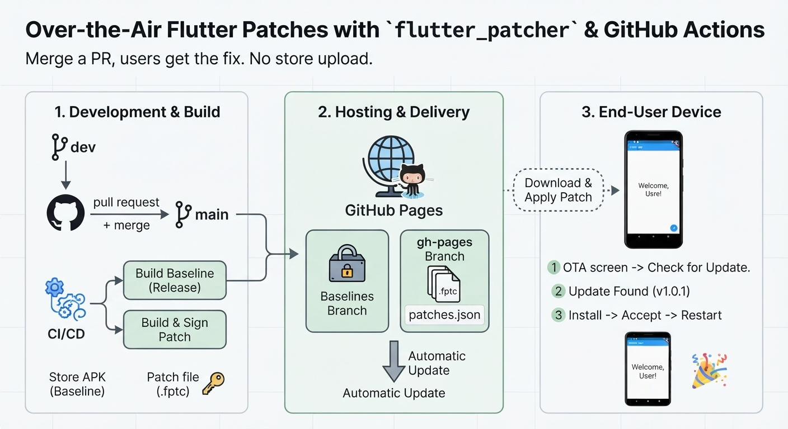

# Ship Flutter Fixes Over the Air with flutter_patcher and GitHub Actions

*Merge a pull request and your users get the change a few minutes later. No store upload, no reinstall. Part 1 of my OTA series.*



---

Picture this. Your Flutter app is live. A user reports a typo on the home screen. The fix is one line, but shipping it means a new build, a store upload, a review, and then waiting for people to update.

What if you could skip that wait for small Dart fixes?

In this post, I'll show you how to fix an issue in a live Flutter app with an **over-the-air (OTA) patch**, using a practice project. You're going to learn how to use **flutter_patcher** with **GitHub Actions** to add OTA updates to a Flutter app. Here's what it does: **you merge a PR into `main`, and the app downloads and installs the fix by itself.**

The stack:

- [**flutter_patcher**](https://github.com/xuelinger2333/flutter_patcher) builds and signs patches of Dart code ([docs](https://github.com/xuelinger2333/flutter_patcher/tree/main/doc))
- [**GitHub Actions**](https://docs.github.com/en/actions) builds the patch on every merge
- [**GitHub Pages**](https://docs.github.com/en/pages) hosts the patch files for free

The full working project is public: 👉 [**souravbarman01/learn_ota**](https://github.com/souravbarman01/learn_ota). The long reference guide is [OTA_GUIDE.md](https://github.com/souravbarman01/learn_ota/blob/main/OTA_GUIDE.md).

---

## How it fits together

The picture at the top shows the whole flow:

1. **Development & build:** you merge `dev` into `main`. GitHub Actions builds and signs a patch against the store build.
2. **Hosting & delivery:** the patch (`.fptc`) and `patches.json` are published to the `gh-pages` branch, served by GitHub Pages.
3. **End-user device:** the app checks for the patch, downloads it, verifies it and restarts with the fix.

Four words to know:

- **Host (store build):** the APK users install.
- **Baseline:** a snapshot of the host. Every patch is compiled against it.
- **Patch (`.fptc`):** only your changed Dart code and assets, signed with your key.
- **Build number:** the part after `+` in `version: 1.0.0+2`. A patch only fits a host with the **same** build number.

---

## Step 1: Pin Flutter

flutter_patcher 1.1.1 supports Flutter **3.47.0 to 3.47.9**. I pinned **3.47.5** everywhere:

```yaml
# pubspec.yaml
environment:
  sdk: ^3.13.4
  flutter: 3.47.5
```

The same version goes into `FLUTTER_VERSION` in both workflows. If the local build, CI and the store build use different Flutter versions, patches won't apply.

## Step 2: Add the packages

```bash
flutter pub add flutter_patcher:1.1.1 http
```

Pin the exact version. Upgrading flutter_patcher later means a new store release.

## Step 3: Initialise and set up signing

```bash
dart run flutter_patcher init
```

This creates [`flutter_patcher.yaml`](https://github.com/souravbarman01/learn_ota/blob/main/flutter_patcher.yaml) and a signing key. Point `url` at your GitHub Pages address:

```yaml
url: https://<user>.github.io/<repo>/patches
trust:
  patch: <generated public key>
  enabled: true      # accept only signed patches
```

The file holds only the **public** key, so it is safe to commit.

Now export the private key for CI:

```bash
dart run flutter_patcher keys export --base64                          # → GitHub secret
dart run flutter_patcher keys export --out flutter_patcher_keys.bundle # → backup
```

- Add the base64 output as a repository secret named `FLUTTER_PATCHER_KEYS` ([how to add secrets](https://docs.github.com/en/actions/security-for-github-actions/security-guides/using-secrets-in-github-actions)).
- Put the `.bundle` file in a password manager. **Never commit it.** If you lose it, you can't patch apps that are already installed.

Add these lines to `.gitignore`:

```gitignore
.flutter_patcher/
*.fptc
flutter_patcher_keys.bundle
```

## Step 4: Create two helper branches

- **`gh-pages`** holds the patches and a `patches/patches.json` list (it starts as `[]`).
- **`baselines`** holds the store build snapshots. Never delete it.

Create both as [orphan branches](https://git-scm.com/docs/git-switch#Documentation/git-switch.txt---orphanltnew-branchgt). The exact commands are in [the guide, §4.6](https://github.com/souravbarman01/learn_ota/blob/main/OTA_GUIDE.md#46-gh-pages-and-baselines-branches). Then turn on Pages for `gh-pages` ([publishing source docs](https://docs.github.com/en/pages/getting-started-with-github-pages/configuring-a-publishing-source-for-your-github-pages-site)).

## Step 5: Add the two workflows

- [**release-host.yml**](https://github.com/souravbarman01/learn_ota/blob/main/.github/workflows/release-host.yml) runs **manually**. It builds the store APK, saves the baseline to `baselines`, and creates a GitHub Release.
- [**ota-patch.yml**](https://github.com/souravbarman01/learn_ota/blob/main/.github/workflows/ota-patch.yml) runs **automatically** on every push to `main` that touches `lib/`, `assets/` or `pubspec`. It builds and signs the patch, then publishes it to `gh-pages`.

The core of the patch workflow is a single command:

```bash
dart run flutter_patcher patch android --out build/patch
```

Everything else in the file is setup, plus a few CI workarounds. Copy [`.github/scripts/`](https://github.com/souravbarman01/learn_ota/tree/main/.github/scripts) along with the workflows. Pushing workflow files needs the `workflow` scope:

```bash
gh auth refresh -h github.com -s workflow
```

## Step 6: Teach the app to fetch patches

Call `FlutterPatcher.init()` before `runApp` ([main.dart](https://github.com/souravbarman01/learn_ota/blob/main/lib/main.dart)). Then add a screen that checks for updates and installs them ([lib/ota/](https://github.com/souravbarman01/learn_ota/tree/main/lib/ota)).

**One gotcha cost me a day.** The built-in `checkUpdate()` doesn't work with GitHub Pages. Dart asks for gzip, Pages compresses the file and then applies the byte range to the *compressed* data, and the result is `FormatException: Not a patch file`.

The fix is to download the patch yourself with `Accept-Encoding: identity` and pass the bytes to `FlutterPatcher.applyPatchBytes()`. See [patch_service.dart](https://github.com/souravbarman01/learn_ota/blob/main/lib/ota/patch_service.dart) and [the guide, §9](https://github.com/souravbarman01/learn_ota/blob/main/OTA_GUIDE.md#9-why-the-app-downloads-patches-itself).

## Step 7: Make the first store release

Run **Actions → Release host (store build) → Run workflow**, or from the terminal:

```bash
gh workflow run release-host.yml -R <user>/<repo>
```

Install the APK from the GitHub Release on an arm64 Android 9+ phone. The OTA screen should say **OTA patching enabled**.

## Step 8: Ship a patch

This is the part you'll repeat for every change:

```bash
git switch dev && git pull
# change something in lib/
flutter analyze && flutter test
git commit -am "Fix home screen label"
git push
gh pr create --base main --head dev --title "Fix home screen label"
```

1. Merge the PR. Its title becomes the patch title in the app.
2. **OTA patch** starts by itself and takes about 2–3 minutes.
3. Wait 1–5 minutes for GitHub Pages to update.
4. On the phone: OTA icon → pull to refresh → **Install** → **Accept**.
5. The app restarts with your change. 🎉

---

## What a patch can't do

- **Only Dart code and assets.** New plugins, changes in `android/` or `ios/`, or a Flutter upgrade need a new store release with a bumped build number.
- **Only APIs the store build already uses.** If the host never used `MainAxisSize`, a patch can't either, and CI fails with `PATCH_UNSAFE`. I wrote [`tool/host_api.sh`](https://github.com/souravbarman01/learn_ota/blob/main/tool/host_api.sh) to check this before writing code.
- **Android arm64, Android 9+.** Other devices just run the store code.
- **Store policies.** Google Play and the App Store restrict apps that download executable code. Read the [Google Play policy](https://support.google.com/googleplay/android-developer/answer/9888379) and [App Store guideline 2.5.2](https://developer.apple.com/app-store/review/guidelines/#software-requirements) before using this in a published app.

When something breaks, the [troubleshooting table](https://github.com/souravbarman01/learn_ota/blob/main/OTA_GUIDE.md#11-troubleshooting) lists every error I hit and its fix.

---

## What's next: OTA with Shorebird

Building this myself showed me how OTA works under the hood: baselines, signing, hosting, and the download itself.

In **Part 2**, I'll do the same thing with [**Shorebird**](https://shorebird.dev), a managed code push service for Flutter. I'll compare its release and patch flow with this setup and look at what it handles for you, like hosting, rollout and rollback. I'll also cover when each approach makes sense.

Follow along so you don't miss it. 👋

---

*Source code: [github.com/souravbarman01/learn_ota](https://github.com/souravbarman01/learn_ota)*
